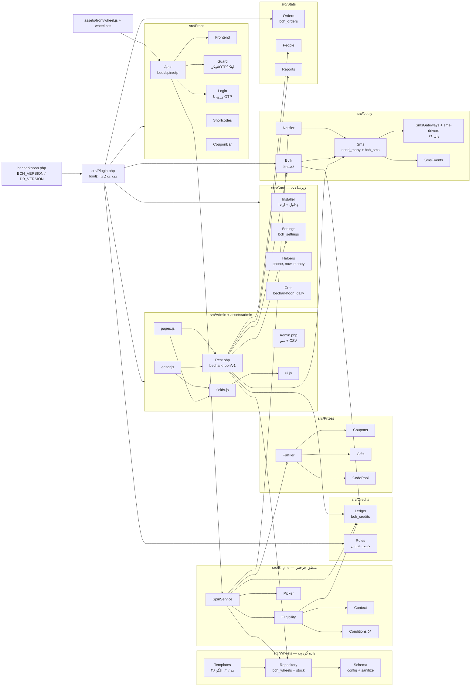
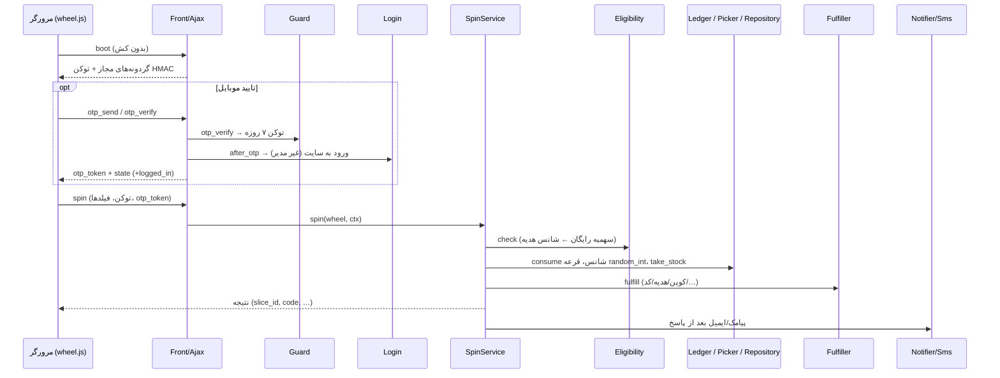
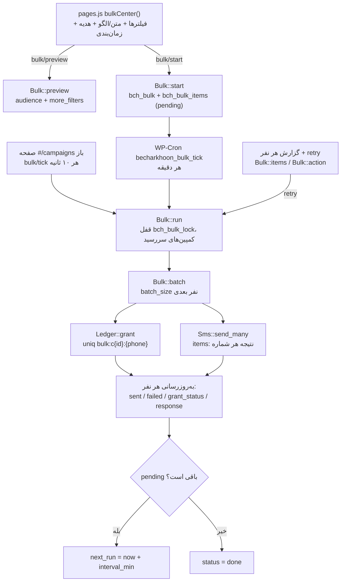
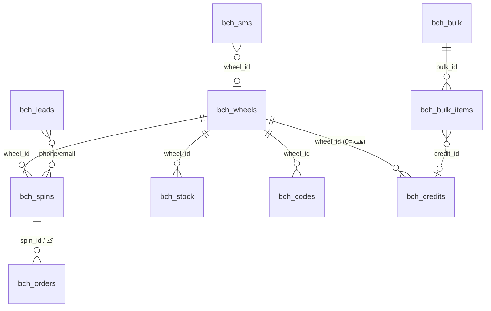

# DIAGRAMS — نمودارهای ساختار و جریان (Mermaid؛ گیت‌هاب خودکار رسم می‌کند)

## ۱. نقشه ماژول‌ها — «برای هر بخش کجا بروم»

## ۲. جریان یک چرخش

## ۳. کمپین پیامک گروهی (1.8.0)

## ۴. جداول دیتابیس

